# The M5.4 analysis across TDBRAIN disorders (2026-10-13)

The analyses and figures we had for MDD vs Healthy, repeated for every clinical group
(`scripts/m54/disorders_analysis.py`; numbers in `outputs/m54_disorders/numbers.json`).

All of the following are eyes-closed recordings with v2 cleaning, using the final M5.4 fits.
- Differences are age- and sex-adjusted.
- Measured differences use each subject's unseen second half.
- "Predicted" means the M5.4 prediction of that half.

| Group | n | Mean age |
|---|---|---|
| Healthy | 133 | 41 |
| MDD (development) | 119 | 46 |
| rTMS-treated MDD | 162 | 45 |
| Adult ADHD | 95 | 35 |
| OCD | 33 | 32 |
| Insomnia | 29 | 49 |
| Tinnitus | 30 | 53 |
| SMC (subjective memory complaints) | 85 | 65 |

**Caveat set aside here, as agreed.** All patient groups except SMC were recorded later than most healthy
volunteers. Every "disorder vs Healthy" contrast below therefore also contains whatever differs between the two
periods. The "disorder vs other patients" contrasts do not have this problem (except for SMC).

---

## Summary

1. **The model fits every group equally well.**
   - Median unseen deviance ratio 0.83–0.89 in every group.
   - 95–100% of subjects beat the population average.
   - No disorder is "harder" for the model.
2. **There is one shared patient profile, not seven separate disorders.**
   - MDD, rTMS-MDD, ADHD, OCD and insomnia share the same parameter changes vs Healthy:
     - lower left dorsal-attention gain, −0.47 to −0.67 SD (Holm-significant in all five);
     - lower right dorsal-attention gain;
     - higher shared alpha drive;
     - lower observation-noise fraction.
   - Their effect profiles correlate r = 0.50–0.90 with each other.
   - Tinnitus and SMC look different.
3. **Little is specific to any one disorder.** Against all other patients:
   - **Insomnia and tinnitus:** stronger visual-network drive than the other patients (+0.4 SD, uncorrected) and than
     Healthy (+0.6 to +0.75 SD, Holm). Their scalp maps also differ (occipital alpha).
   - **SMC:** the left dorsal-attention gain is +0.49 SD higher than in other patients (Holm). SMC is the only group
     without the patient profile.
   - **MDD:** nothing survives correction. The largest effect is right salience drive, +0.28 SD, uncorrected.
4. **The scalp patterns are shared too.**
   - Alpha: lower centro-parietal, higher occipital/temporal. Beta and theta show their own shared patterns.
   - These appear in MDD, rTMS-MDD, ADHD, OCD and tinnitus alike.
   - M5.4 reproduces each disorder's pattern (r = 0.70–0.89 for alpha/beta), at reduced amplitude.
5. **Patients have more relative 20–40 Hz power** at parietal, central and frontal sites. This holds for MDD,
   rTMS-MDD, ADHD and tinnitus, not SMC. The model does not reproduce it. Medication (benzodiazepines and many
   antidepressants raise beta) or muscle activity are candidates.
6. **Lagged alpha connectivity changes the same way in every patient group** (pattern r = 0.74–0.96 between groups).
   It is a general "patient vs healthy" signature, as found earlier for MDD.
7. **Classification:**
   - Disorder vs Healthy: AUC 0.57–0.85.
   - Disorder vs other patients: AUC 0.49–0.72.
   - MDD vs other patients: 0.54 (parameters) and 0.62 (plain EEG).
   - Best single result: insomnia vs Healthy from model parameters, AUC 0.85 (plain EEG 0.71), but n = 29.
   - The parameters do not separate disorders from each other better than plain EEG features.

---

## 1. Fit quality

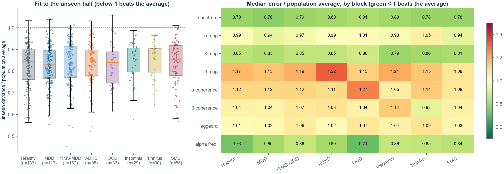

| Group | Median deviance ratio | Beat the average | Spectrum | α map | β map | α coherence | Alpha frequency |
|---|---|---|---|---|---|---|---|
| Healthy | 0.846 | 99% | 0.79 | 0.99 | 0.85 | 1.12 | 0.73 |
| MDD | 0.832 | 99% | 0.77 | 0.94 | 0.83 | 1.12 | 0.80 |
| rTMS-MDD | 0.834 | 99% | 0.79 | 0.97 | 0.85 | 1.12 | 0.86 |
| ADHD | 0.851 | 99% | 0.80 | 0.99 | 0.85 | 1.11 | 0.80 |
| OCD | 0.840 | 97% | 0.81 | 1.01 | 0.88 | 1.27 | 0.71 |
| Insomnia | 0.861 | 100% | 0.80 | 0.98 | 0.79 | 1.05 | 0.86 |
| Tinnitus | 0.885 | 100% | 0.78 | 1.05 | 0.80 | 1.14 | 0.85 |
| SMC | 0.853 | 95% | 0.78 | 0.94 | 0.81 | 1.08 | 0.84 |

The same weak spots appear everywhere: theta map and zero-lag coherence worse than the population average.

## 2. Parameters

### 2.1 Each disorder vs Healthy

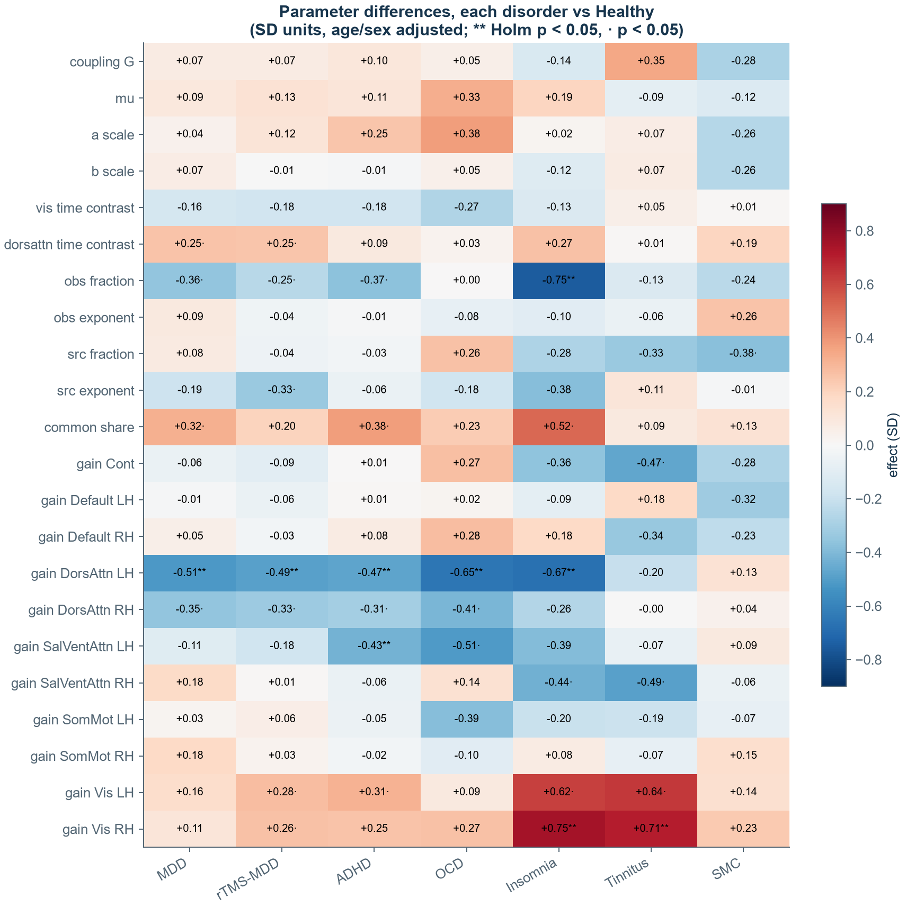

Holm-significant (within each disorder):
- **MDD:** left dorsal-attention gain −0.51.
- **rTMS-MDD:** left dorsal-attention gain −0.49.
- **ADHD:** left dorsal-attention −0.47, left salience −0.43.
- **OCD:** left dorsal-attention −0.65.
- **Insomnia:**
  - left dorsal-attention −0.67;
  - right visual +0.75;
  - observation-noise fraction −0.75.
- **Tinnitus:** right visual +0.71.
- **SMC:** none.

### 2.2 Each disorder vs all other patients (what is specific)

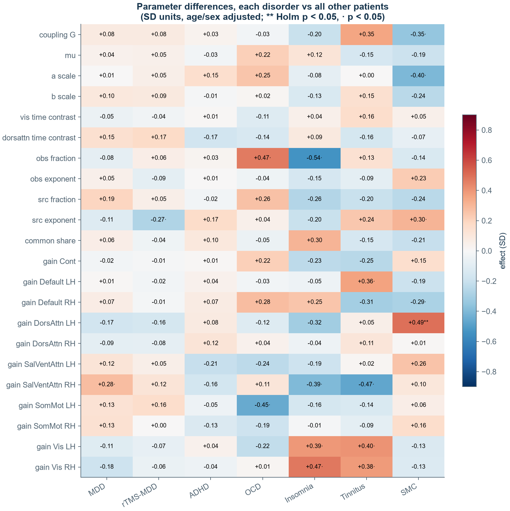

For the MDD groups, "other patients" excludes the other MDD group.
- **Holm-significant:** only SMC, left dorsal-attention +0.49.
- **Uncorrected, p < 0.05:**
  - insomnia and tinnitus: visual drive +0.38 to +0.47; right salience −0.39 to −0.47;
  - OCD: left somatomotor −0.45; observation fraction +0.47;
  - tinnitus: left default +0.36;
  - MDD: right salience +0.28.
- **No MDD-specific parameter.**

### 2.3 How similar are the disorders?

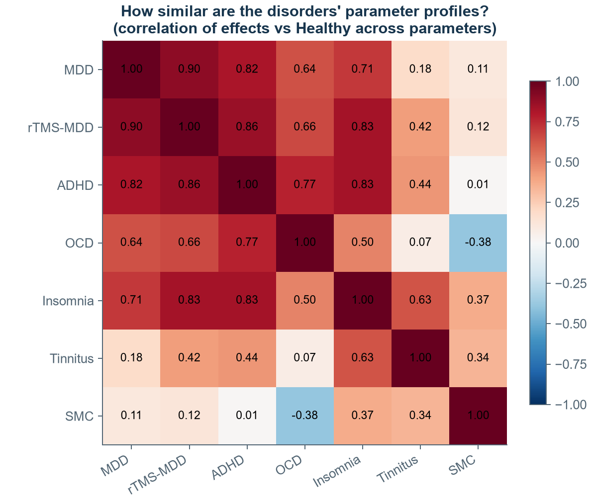

Correlation of parameter-effect profiles (vs Healthy):
- MDD ~ rTMS-MDD 0.90, ADHD 0.82, insomnia 0.71, OCD 0.64.
- ADHD ~ insomnia 0.83, OCD 0.77.
- Tinnitus 0.07–0.63 with the others.
- SMC −0.38 to 0.37 with the others.

So most clinical groups differ from Healthy *in the same direction*.

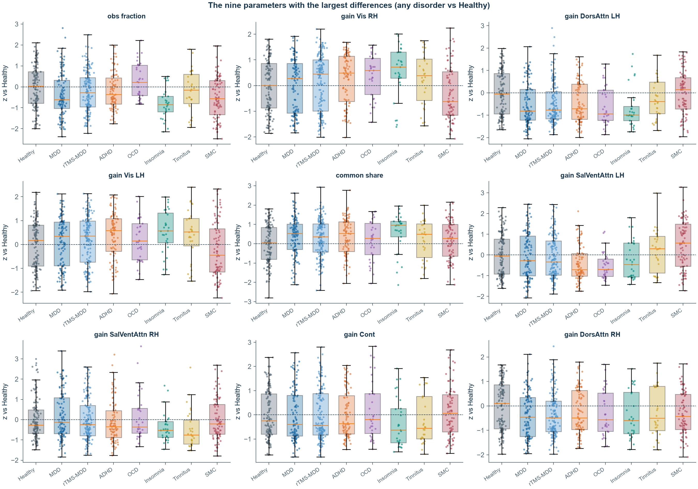

## 3. Scalp maps: measured vs predicted

| Band | r(measured, predicted) across disorders | FDR-significant channels |
|---|---|---|
| Alpha | 0.56 (SMC) – 0.87 (MDD) | MDD 7, rTMS-MDD 12, tinnitus 4, others 0 |
| Beta | 0.61 (SMC) – 0.89 (rTMS-MDD) | MDD 10, rTMS-MDD 12, OCD 4 |
| Theta | 0.53 (insomnia) – 0.76 (tinnitus) | rTMS-MDD 11, OCD 5, tinnitus 5, MDD 4 |

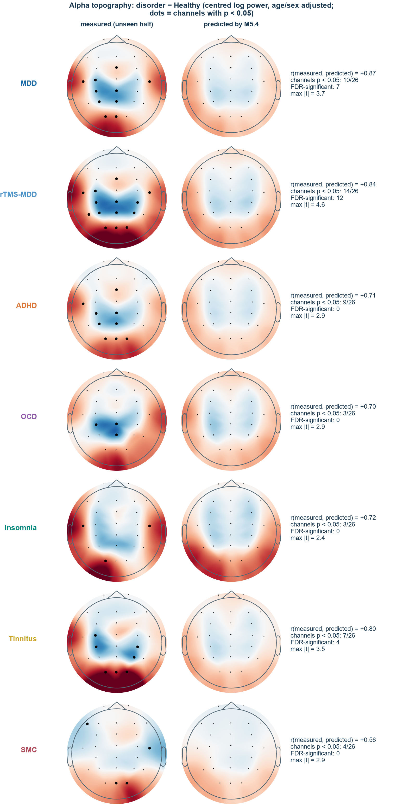
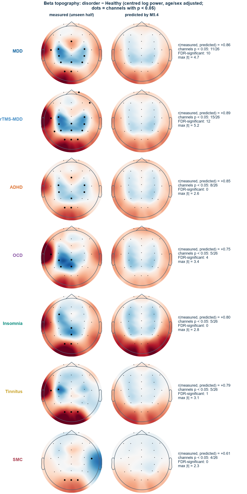
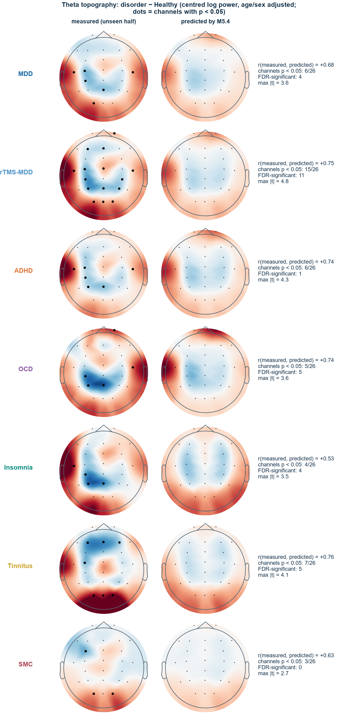

## 4. Spectra and coherence

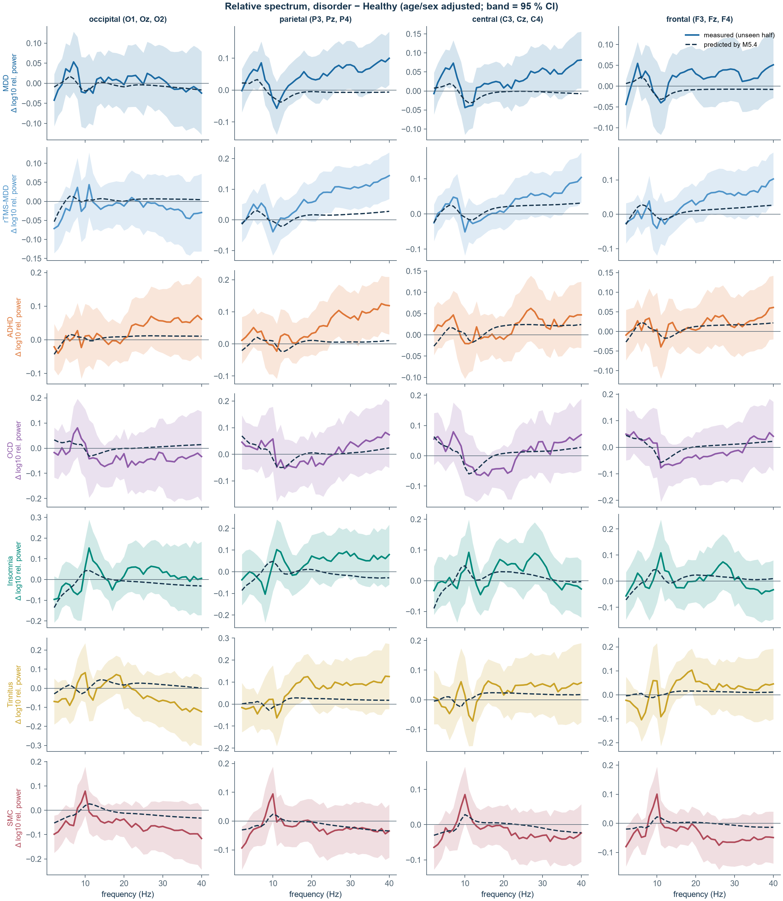

- **Higher relative 20–40 Hz power** in MDD, rTMS-MDD, ADHD and tinnitus at parietal, central and frontal sites,
  up to +0.1 log10. The model predicts almost none of it.
- **Insomnia and SMC:** higher relative alpha at all sites.
- **OCD:** lower 10–20 Hz.

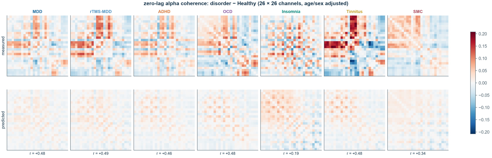
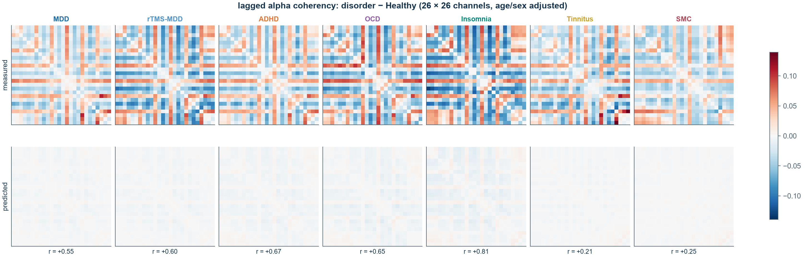

- **Zero-lag alpha coherence:**
  - Slightly higher in all patient groups; the measured difference pattern agrees with the prediction at
    r = 0.19–0.49.
  - Patterns are similar across MDD / rTMS-MDD / ADHD (r ≈ 0.9) but differ for OCD, insomnia and SMC.
- **Lagged alpha coherency:**
  - Lower in all patient groups, with nearly the same pattern everywhere: r = 0.80–0.96 between disorders, 0.74–0.87
    with SMC.
  - The model reproduces it at r = 0.55–0.81, except tinnitus and SMC (≈ 0.2).

## 5. Classification

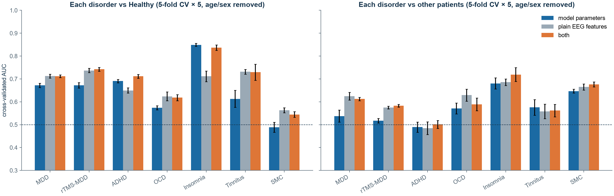

| AUC | MDD | rTMS-MDD | ADHD | OCD | Insomnia | Tinnitus | SMC |
|---|---|---|---|---|---|---|---|
| vs Healthy, parameters | 0.67 | 0.67 | 0.69 | 0.57 | **0.85** | 0.61 | 0.49 |
| vs Healthy, plain EEG | 0.71 | 0.74 | 0.65 | 0.62 | 0.71 | 0.73 | 0.56 |
| vs other patients, parameters | 0.54 | 0.52 | 0.49 | 0.57 | 0.68 | 0.58 | 0.65 |
| vs other patients, plain EEG | 0.62 | 0.58 | 0.49 | 0.63 | 0.69 | 0.56 | 0.67 |

Method: logistic regression, 5-fold cross-validation × 5, age/sex removed within training folds. Plain EEG features
are relative band powers in 4 regions, individual alpha frequency, alpha topography and total power.

## 6. Interpretation

- **What the model's parameters encode across TDBRAIN is mostly one thing: patient vs healthy volunteer.** The same
  change appears in depression, ADHD, OCD and insomnia, in the parameters, scalp maps and lagged connectivity. It
  could be:
  - a shared biological feature of these patients (medication, chronic distress, sleep, arousal);
  - something that differs between the recruitment or recording of patients and volunteers.

  This analysis cannot tell which. The 15 late-recorded healthy volunteers resembled the early ones, and SMC (an
  early-period group) lacked the profile.
- **Specific effects are few:**
  - visual-network drive in insomnia and tinnitus;
  - the SMC group being different from all other patients.
- **Nothing is specific to depression.**
- **The unmodelled 20–40 Hz excess in patients** is worth checking against medication records, which are not in the
  public participant table.
